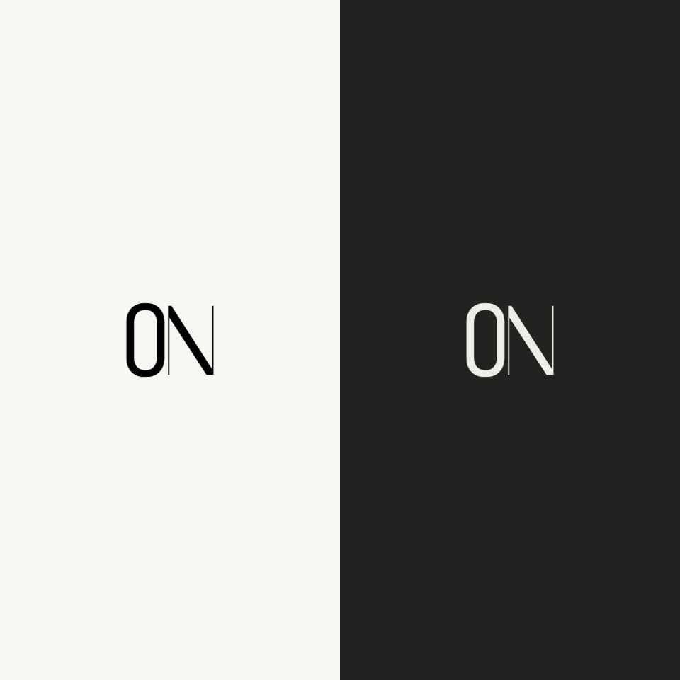

# Run the updated OFFDAY Note

The design, ON app icon and light/dark splash updates are saved in the source. No Android/iOS app build, APK generation, native project regeneration or Expo app export was run for this update. No commits were made.

## What changed

- Your uploaded ON artwork is the app icon, with padding for Android launcher masks.
- The splash shows the centered ON mark on a plain light or dark background. It stays visible while SQLite opens and fades into the app, or reveals the error screen if startup fails.

- Removed the large home headline, introductory copy and note-count/device footer.
- Put search at the top, beside a Settings gear that opens the Settings page. Archive and Backup & restore live in Settings.
- An empty notebook has a single centered + button.
- With notes, the + button floats at the bottom right. The list has space beneath its last note so the button does not cover it.
- Settings uses grouped rows and small selection sheets for theme, spacing and font.
- The editor follows keyboard/visual-viewport resizing. Touch formatting controls retain focus, and the reminder label sits above the writing area.

## Latest polish

- White, the existing Olive, and true Black themes. System default follows White/Olive. Existing Olive preferences are preserved.
- Hidden scrollbars throughout lists, settings, sheets and the editor; scrolling still works.
- Swipe a note right to pin/unpin, left to archive. Swipe left in Archive to restore. Screen readers expose the same actions.
- A small save-status icon beside note actions replaces the long header text: check = saved, circle = saving, exclamation = failed. Failed saves retain the retry controls.
- A cleaner reminder page with three shortcuts, date/time rows, one main action and a menu for cancel/complete. iOS date/time selection opens in a sheet.
- Links accept HTTP, HTTPS, mailto and bare domains; bare domains receive HTTPS. Unsafe protocols are rejected.
- Editor font choices: System, Sans, Serif, Book and Monospace. These use offline device font stacks; the exact face depends on the platform, with fallbacks when a font is unavailable.
- Your original ON icon is retained.

## Deletion and in-app branding fix

Confirmed deletion discards the note without requiring an editor snapshot or a successful autosave first. After the database delete succeeds, queued autosave is stopped, the old editor content is cleared, the notebook refreshes and navigation returns home. Failed deletion keeps the note open and reports an error.

A small ON icon and OFFDAY Note name appear above home search; the search/Settings row and minimalist layout are retained. Launcher/splash artwork and the OFFDAY Note app name remain configured in `app.json`. Run prebuild below to apply them to native resources, then install the newly generated APK over your current app.

## Colored tags and long-press actions

- Hold any note to open its actions: Add tags, reminder, pin/unpin, archive/restore and confirmed delete.
- Choose Add tags to open the bottom sheet. Select existing tags, then tap Save tags. To create one, tap ＋ Create tag; a separate New tag view shows the name and color choices. Tap Create & select to return to the list with that tag selected, then Save tags. Closing the sheet cancels assignment changes; a newly created tag remains available for other notes.
- While creating or editing a note, tap Tags below its title or use Add tags in the note menu.
- Assigned tags appear as compact chips with colored dots in the list and editor.
- Tags stay offline in SQLite. The schema update preserves existing notes. Version 2 backups include colors and assignments; old version 1 backups still restore.
- No app build or commit was run for this feature. Native long-press and keyboard/sheet layout still need checking after your build.

## Editor and tag flow fixes

Tag selection and creation are separate views with one primary action in each: Save tags or Create & select. New notes show Title (optional) and Start writing here… in the content area, including when ProseMirror renders a trailing line-break element. Heading opens a chooser for H1–H6 with superscript levels; the toolbar displays the current level. Bold and Italic show their active state immediately before typing. Adding a link without selected text inserts the visible address; selected text is linked without being replaced, and editing inside an existing link updates its range.

## Wordmark and save status

The home header now centers Offday Note in light sans-serif typography inspired by the ON mark, without an adjacent icon. The ON launcher/splash artwork is retained. Platform fonts are Helvetica Neue Thin on iOS and sans-serif-thin on Android; this is a typographic interpretation, not an identified font from the raster logo. Save status uses a small neutral capsule with a dot and Saved/Saving/Not saved text; existing retry controls remain on failure. The launcher display name is now Offday Note; run prebuild below to apply it. No app build or commit was made.

## Latest editor, splash and list refinement

- The native Android 12+ splash has a bottom Offday Note wordmark using a config plugin. The matching startup view shows the ON mark and bottom name while SQLite opens on all platforms. There is no artificial startup delay. Earlier Android and iOS native launch screens initially show ON, then transition to this startup view.
- The empty notebook says only Your first note above its centered +.
- Heading taps cycle H6 → H5 → H4 → H3 → H2 → H1 → H6. Hold for 450 ms to choose H1–H6 or Paragraph. Keyboard Arrow Down/right click also opens the chooser.
- Undo and Redo icons stay fixed on the right of the toolbar; formatting tools scroll independently. History buttons reflect whether an action is available.
- Paragraph spacing and line height are tighter. Live checklist items now carry the attribute used for horizontal checkbox/text layout; the checkbox stays beside the first text line.
- List dates share the title row. Titles truncate to one line and previews to two; reminders remain a separate concise line only when needed.

Run prebuild below to apply the new native splash wordmark. No app build or commit was run here.

## Build an Android APK

Run these commands from your terminal:

```sh
cd "/Users/souravsaha/Documents/Developer/android app/minimalApp/offday_notes"

# Refresh the icon/splash assets from the saved original.
npm run prepare:brand

# Refresh the local rich-text editor asset.
npm run build:editor

# Check the source before building.
npm run typecheck
npm run lint
npm test

# Apply the new native icon and splash configuration.
npx expo prebuild --platform android --no-install

# Compile the release APK.
cd android
NODE_ENV=production ./gradlew :app:assembleRelease --no-daemon
```

Your updated APK will be here:

```text
/Users/souravsaha/Documents/Developer/android app/minimalApp/offday_notes/android/app/build/outputs/apk/release/app-release.apk
```

The APK is for local testing and uses the existing generated test signing key.

**Run prebuild for this update even if `android` already exists.** Icons and native splash resources come from `app.json`; skipping that step keeps the previous branding. Native regeneration is included above for you to run.

If `node_modules` is missing, run `npm ci` in `offday_notes` first.

## Install on your connected Android device

```sh
adb install -r "/Users/souravsaha/Documents/Developer/android app/minimalApp/offday_notes/android/app/build/outputs/apk/release/app-release.apk"
```

After installing, open a note and type with the keyboard visible. Tap Bold, Italic and Checklist, and swipe the toolbar horizontally. The formatting controls should remain above the keyboard without requiring you to close it. Also check White/Olive/Black, note swipes and the reminder date/time picker on your device. Real-device keyboard behavior still needs this check; the automated test simulates viewport resizing and touch focus handling.

## Optional iOS build

On a Mac with full Xcode and CocoaPods configured:

```sh
cd "/Users/souravsaha/Documents/Developer/android app/minimalApp/offday_notes"
npm run prepare:brand
npm run build:editor
# Regenerate to apply the new native icon and splash resources.
npx expo prebuild --platform ios
npm run ios
```

## Checks already completed for this revision

- Strict TypeScript check passed.
- Expo lint passed.
- All 45 tests passed, including the keyboard viewport/touch-control regression test.
- No app build was run. The earlier APK and browser export do not include the current design and branding until you rebuild them.
- Icon/splash dimensions, transparency and adaptive-icon safe padding are checked by `prepare:brand`. Native splash/launcher appearance still needs verification after your build.

## Branding source and previews

The uploaded file is preserved at `assets/brand/on-source.png`. Generated assets are in `assets/images/offday-*.png`. The app icon uses your original light gray background; the splash uses plain light and Olive backgrounds. No artificial splash delay is added.



This is an asset layout preview, not a captured native launch screen. Preview the actual splash by fully closing and reopening your release build. Expo Go does not reproduce the complete native splash configuration. See [Expo's splash screen documentation](https://docs.expo.dev/versions/v57.0.0/sdk/splash-screen/).
